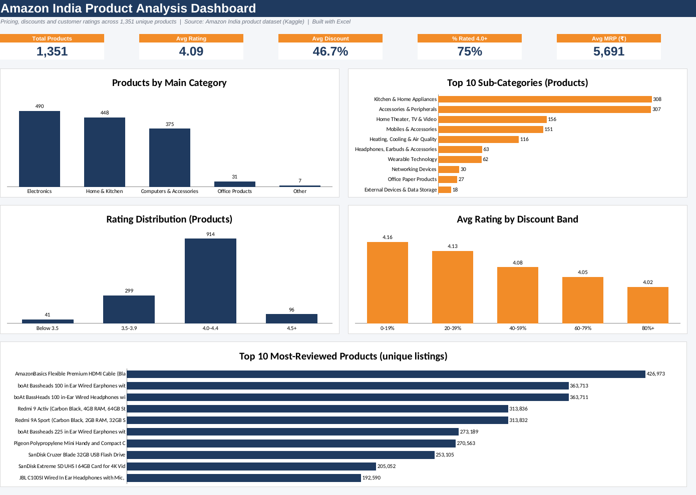

# Amazon India Product Analysis Dashboard (Excel)

An Excel dashboard analysing pricing, discounts and customer ratings across 1,351 unique Amazon India products.

## Business questions
1. Which categories have the most products, and how do their ratings compare?
2. How deep are the discounts, and do bigger discounts go with better or worse ratings?
3. How are ratings distributed across the catalogue?
4. Which products attract the most reviews?

## Key insights
- **Rating quality is high overall:** average rating is 4.09 and 75% of products are rated 4.0 or above.
- **Electronics is the largest category** (490 products), followed by Home & Kitchen (448) and Computers & Accessories (375).
- **Average discount is 46.7%.** Wearable Technology has the deepest average discount (about 70%), while Office Products has the lowest (about 12%).
- **Bigger discounts go with slightly lower ratings:** average rating falls from 4.16 (0-19% off) to 4.02 (80%+ off). This is a pattern in the data, not proof of cause.
- **Headphones, Earbuds & Accessories** has the lowest average rating among the top sub-categories (3.92) despite heavy discounting (about 59%).

## Data
- Source: Amazon India product dataset (Kaggle), 1,465 rows in the raw file.
- Note: the dataset has no dates or units-sold column, so this is a pricing, discount and rating analysis, not a sales-revenue analysis.

## Cleaning steps
1. Removed 114 duplicate Product IDs (1,465 to 1,351 rows).
2. Stripped the ₹ symbol and commas from price columns and converted them to numbers.
3. Converted Discount % from text to a numeric value.
4. Set one invalid rating value ("|") to blank; two missing rating counts left blank.
5. Split the category path into Main Category and Sub Category.
6. Dropped columns not needed (review text, user IDs, links).
7. Added helper columns: Discount Amount, Discount Band, Rating Band.

## Workbook structure
| Sheet | Purpose |
|---|---|
| Dashboard | KPI cards and 5 charts |
| Analysis | Summary tables (COUNTIFS, AVERAGEIFS, INDEX/MATCH) that feed the charts |
| Data | Cleaned dataset |
| Cleaning Log | Every cleaning step with row counts |

## Tools
Excel (formulas, tables, charts, dashboard design), Python (pandas) for the initial cleaning pass.

## Author
V V S Naveen Kumar | Data Analyst | Hyderabad, India
GitHub: vnaveen088-ai
